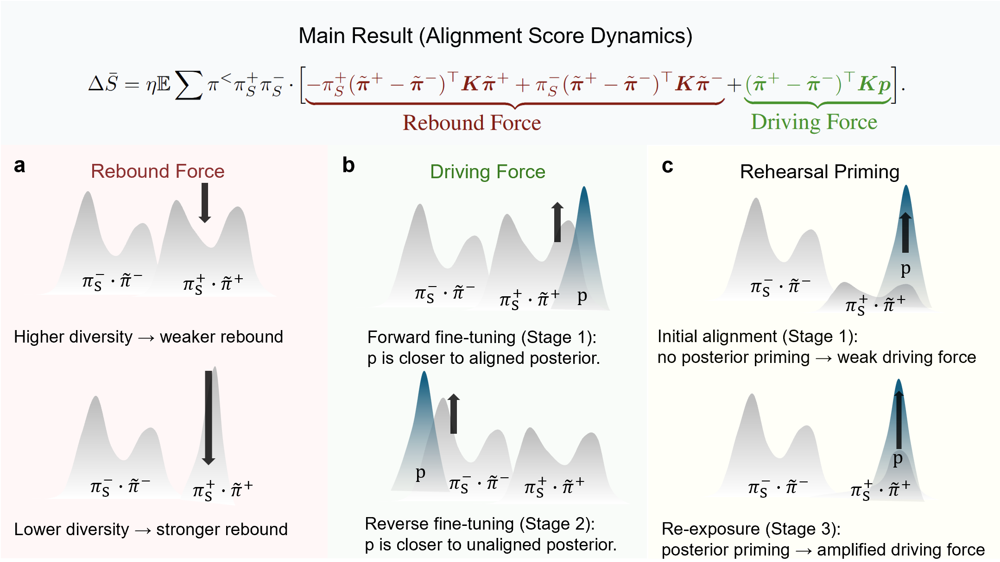
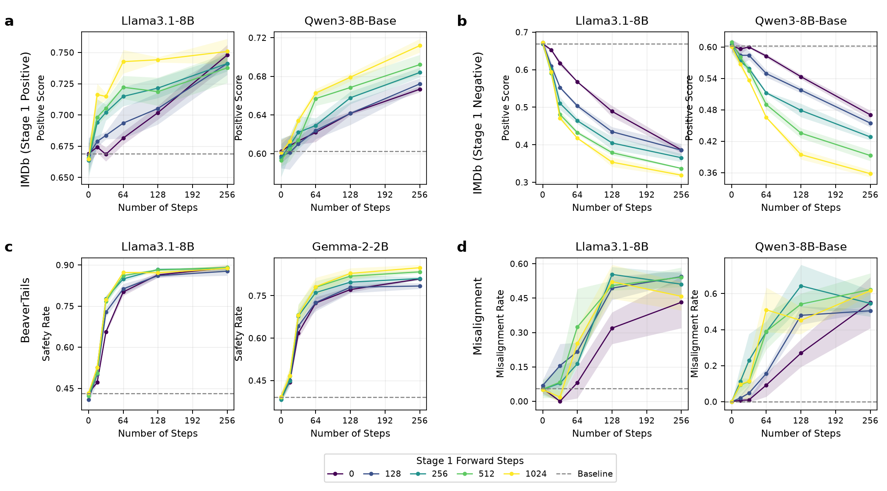

# Alignment Dynamics in LLM Fine-Tuning

**Yuhan Huang · Huanran Chen · Yinpeng Dong**  
**NeurIPS 2026** · [Paper](https://arxiv.org/abs/2605.18309)

Code and experimental results for *Alignment Dynamics in LLM Fine-Tuning*.



We derive an alignment update that separates an intrinsic **Rebound Force** from the **Driving Force** induced by fine-tuning data. The framework predicts **Rehearsal Priming**: prior exposure can accelerate adaptation upon re-exposure, even after the behavioral score has returned near its baseline. Experiments cover safety alignment, emergent misalignment, bidirectional sentiment fine-tuning, and the effect of response diversity.

## Installation

Run commands from the repository root with Python 3.10 or newer:

```bash
python3.10 -m venv .venv
source .venv/bin/activate
python -m pip install -e '.[analysis]'
```

For CUDA training and data preparation, also install:

```bash
python -m pip install -e '.[train,data]'
```

See [environment setup](docs/ENVIRONMENT.md) for the training dependencies and hardware requirements.

## Generate figures from the released results

The released checkpoint metrics support plotting on CPU without model downloads:

```bash
python -m alignment_dynamics.plot --figure all
python -m alignment_dynamics.table3
```

Figures 2–6 are saved as PDF, SVG, and PNG under [artifacts/figures](artifacts/figures). The plots follow the paper's panel order and grouping and show the mean ± one population standard deviation across the selected data seeds 1, 2, and 3. Each figure also exports its plotted values and per-seed observations to a `figureN_points.csv` file. Table 3 likelihood measurements are exported to `artifacts/tables/table3.csv`.

Generate an individual figure with `--figure figure4`. Use `--paper-single-seed --output runs/single_seed_figures` for the individual-run trajectories in the arXiv figures; the response-diversity experiment uses the selected single seed in that mode as well. See [figure reproduction](docs/REPRODUCIBILITY.md) for the exact inputs and statistics.



*Rehearsal Priming Effect: longer prior exposure accelerates adaptation upon re-exposure.*

## Run the experiments

Prepare the datasets using [data preparation](docs/DATA.md). For experiments that start from Alpaca-prewarmed models, set the corresponding checkpoint paths in [configs/models.env.example](configs/models.env.example).

Preview a complete figure's training schedule and check the data:

```bash
python -m alignment_dynamics.reproduce --figure figure2 --check-data
```

Run that schedule on four GPUs:

```bash
python -m alignment_dynamics.reproduce --figure figure2 --execute
```

Outputs are organized by task and run under `runs/paper/`. Generate figures from a new training run with:

```bash
python -m alignment_dynamics.plot --figure figure2 \
  --metrics-root runs/paper --output runs/paper_figures
```

Individual configurations can also be run directly:

```bash
python -m alignment_dynamics.run \
  --config experiments/imdb/configs/gemma-2-2b_imdb/reverse128.yaml \
  --run-name imdb-gemma-seed1 --num-processes 4 \
  --stages 0 1 2 3 4 --execute
```

The [reproduction guide](docs/REPRODUCIBILITY.md) describes stage selection, depth sweeps, seeds, and the commands for each figure. The default hardware setup is **4 × NVIDIA A800 80 GB**, BF16, full-parameter SFT, and DeepSpeed ZeRO-2.

## Repository structure

```text
alignment_dynamics/  Training, evaluation, figure schedules, and plotting
experiments/         Configurations for the paper experiments
configs/             Distributed runtime and model-checkpoint variables
data_preparation/    Dataset processing scripts and input checksums
analysis/            Figure, run, and configuration selections
artifacts/           Checkpoint metrics, figures, and tables
assets/              Overview illustration
docs/                Reproduction, datasets, and environment instructions
tests/               Plot statistics and experiment-entrypoint checks
```

## License

This repository is licensed under [CC BY 4.0](LICENSE). Third-party models, datasets, and libraries retain their own licenses; see [NOTICE.md](NOTICE.md).

## Citation

If you find this work useful in your research, please cite our paper:

```bibtex
@inproceedings{huang2026alignment,
  title     = {Alignment Dynamics in LLM Fine-Tuning},
  author    = {Huang, Yuhan and Chen, Huanran and Dong, Yinpeng},
  booktitle = {Advances in Neural Information Processing Systems},
  year      = {2026},
  url       = {https://arxiv.org/abs/2605.18309}
}
```
